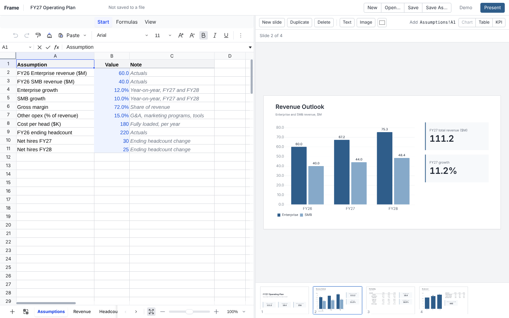

# Frame

One workspace for spreadsheet analysis and the presentation built from it. The model sits on the left and the slides on the right. Charts, tables and KPIs on the slides stay live-linked to the cells they came from, so changing an assumption updates the deck with no copy, paste, export or refresh.

This is **Frame MVP 0.1**, a 30-day, local-first build for one question: do financial and analytical practitioners prefer doing the analysis and the presentation in one continuously linked workspace?



## Run it

You need **Node.js 22** (or 20.19+) and **Chrome or Edge** on a desktop, ideally with a window of at least 1440 × 900.

```
git clone https://github.com/abiyjgas-jpg/Frame.git
cd Frame
npm install
npm start          # builds, serves http://localhost:4173 and opens it
```

Everything runs on your machine. There's no account and no server, and nothing is sent anywhere. Projects are files you save yourself.

## Five-minute demo

Frame opens on the **FY27 Operating Plan** demo. **Demo** in the top bar brings back a fresh copy at any time.

1. **Point out both halves.** The model is on the left, with sheets Assumptions, Revenue, Headcount and P&L. The deck is on the right, with slides FY27 Operating Plan, Revenue Outlook, Profitability and Headcount.
2. **Show the slides on Revenue Outlook.** The chart and KPIs show FY27 revenue of 111.2. On Profitability, EBITDA is 18.4.
3. **Change an assumption.** On Assumptions, change Enterprise growth (B4) from 12% to 8% and press Enter. Revenue falls to 108.8 and EBITDA to 17.0, and the chart, table, KPIs and thumbnails update at once. Nothing was refreshed or pasted.
4. **Trace a number.** Click the revenue chart. The bar above the slide shows its source, `Revenue!A1:D3`. Click **Go to source** and the sheet jumps there and selects it. The reverse also works: select cells in the model and every slide object that reads them is outlined.
5. **Build something.** Select a range in the model, for example P&L A1:D7, and click **Chart**, **Table** or **KPI** (for a single cell) in the Add group. The new object is linked from the start.
6. **Present.** Click **Present**. Arrow keys or a click move between slides, and Escape exits.
7. **Save and reopen.** Press Ctrl+S to save a `.frame` file. Close the tab, reopen Frame, then Open… the file. Sheets, formulas, formatting, slides and links are all there and still live.

## Using Frame

| | |
|---|---|
| Add to Presentation | Select cells, then use **Chart**, **Table** or **KPI** above the slide. A chart reads a header row and label column automatically. |
| Linked objects | Click one to see its source and **Go to source**. Charts can be column, bar or line. |
| Objects | Drag to move. Resize from the handles. Use the arrow keys to nudge (Shift moves 10). Delete removes; Ctrl+D duplicates. Align, bring to front and send to back are in the object bar. |
| Text | **Text** adds a box. Double-click or press Enter to edit, and Escape to finish. Set size, bold, italic, colour and alignment in the object bar. |
| Images | **Image** inserts a PNG, JPEG, GIF, WebP or SVG up to 5 MB. Images are stored inside the project file. |
| Slides | New, Duplicate (links stay live), Delete, background colour. Drag thumbnails to reorder. |
| Present | Use → ↓ Space or click for next; ← ↑ for previous; Home and End to jump; Escape to exit. |
| Files | New, Open… (Ctrl+O), Save (Ctrl+S), Save As… (Ctrl+Shift+S). In Chrome and Edge, Save asks once and then saves in place. Other browsers download the file. |
| Spreadsheet | Univer provides formulas (including across sheets), number formats, bold, fonts, fill, borders, row and column sizes, copy and paste, multiple sheets, renaming, keyboard navigation and undo. |

Unsaved changes are kept in the browser, so a reload or crash doesn't lose work. The top bar shows "Unsaved changes" until you save to a file.

## Known limitations

These are deliberate for an MVP, or not yet built.

- **Desktop Chrome or Edge only.** Other browsers may work but aren't tested. There's no mobile or touch support.
- **Local only.** There's no sharing, collaboration, comments or accounts. Hand someone the `.frame` file to share a project.
- **No import or export.** Frame doesn't read or write Excel, PowerPoint or Google files.
- **Slide edits have no undo.** The spreadsheet has its own undo.
- **One selected object at a time.** There are no snapping guides and no grouping.
- **Charts:** column, bar and line only. There's no waterfall, stacking or per-series styling.
- **Tables** show the sheet's number formats but not its bold, fills or borders. Tables are capped at 25 × 12 cells and charts at 600 cells.
- **Deleted cells:** links follow their cells when rows or columns are inserted or deleted. If every linked cell is deleted, the object shows that its source is gone (`#REF!`), and Undo doesn't relink it. Delete the object and add it again.
- **After a reload**, the first Save asks for the file location again, because browsers don't keep file access across reloads.
- **Browser storage:** the in-browser copy holds about 5 MB. Very large images can stop the automatic copy, and the browser then warns before you leave. Saving to a file has no such limit.
- **Scale:** tested for small models. The target is about 10 sheets, 10,000 populated cells, 20 slides and 50 links.

## Running test sessions

[docs/FEEDBACK_CHECKLIST.md](docs/FEEDBACK_CHECKLIST.md) has the session plan: setup, the tasks to give participants, what to watch for, and the questions that test the hypothesis.

## Development

```
npm run dev        # dev server with hot reload (about 3× slower than the production build)
npm test           # unit tests (Vitest)
npm run e2e        # browser tests (Playwright) against the production build, including the spec's acceptance test
npm run licenses   # regenerate public/THIRD_PARTY_LICENSES.txt after changing dependencies
```

Code map:
- `src/spreadsheet` is the `SpreadsheetAdapter` interface, plus the only file that imports Univer.
- `src/bindings` holds ranges and the BindingManager, which keeps linked values current.
- `src/presentation` holds slides, objects, charts, tables, Present mode, and pure deck operations.
- `src/project` covers the `.frame` format, files on disk and the in-browser copy.
- `src/demo` holds the FY27 demo.
- `src/app` is the workspace UI.

`docs/` has the spike plan and results and notes for each milestone.

## Licenses

Frame is built on [Univer](https://github.com/dream-num/univer) (Apache-2.0; the open-source packages only, no Pro features), [Chart.js](https://www.chartjs.org/) (MIT) and React (MIT). The licenses of every package shipped in the app are in `public/THIRD_PARTY_LICENSES.txt`, which is served with every build at `/THIRD_PARTY_LICENSES.txt`.
